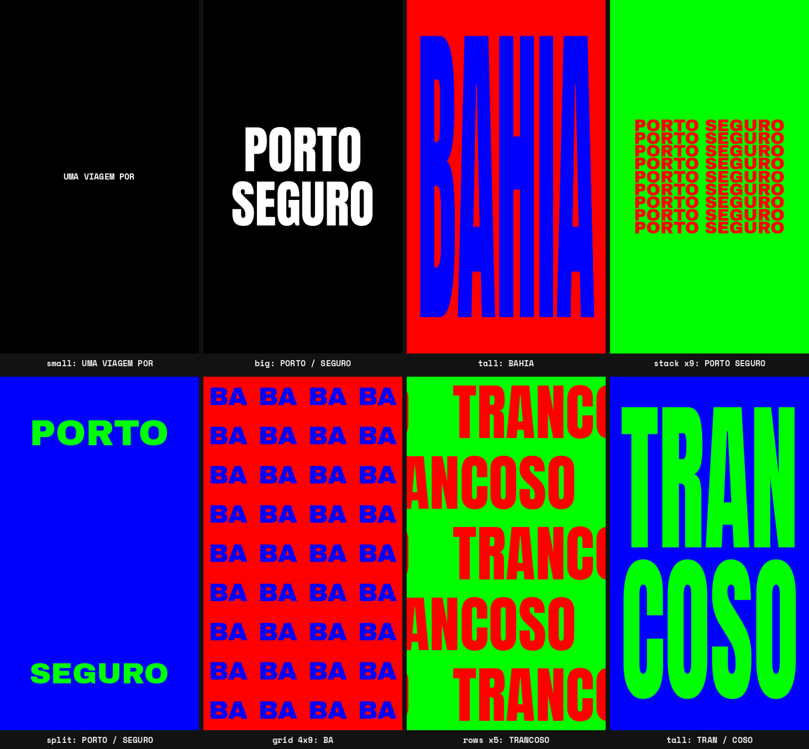

# reelbeat

Gera vídeos verticais (Reels, Shorts, TikTok) **cortados na batida da música** a partir de uma pasta de fotos e vídeos.

Você aponta a música e as pastas da viagem. O reelbeat encontra as batidas, os impactos e as subidas da música e monta um **roteiro editável** em YAML, já sincronizado. Depois renderiza o vídeo em 1080×1920 com a música.

```bash
reelbeat auto musica.mp3 midia/ --subtitle BAHIA --tag BA --render
```



## O que ele faz

- **Analisa a música**: BPM, grade de batidas, *drop*, impactos e subidas (os trechos que crescem até explodir).
- **Monta o roteiro sozinho**:
  - abertura em preto com os nomes dos lugares;
  - o subtítulo aparecendo por dentro das letras do primeiro vídeo;
  - fotos calmas → rápidas → rajada até o drop;
  - estrobo RGB no drop;
  - uma cartela RGB por capítulo;
  - vídeos que aceleram nas subidas e caem no impacto;
  - final com título e crédito.
- **Roteiro em YAML**, em batidas: troque fotos, textos e tempos à mão e renderize de novo.
- **Lê fotos do iPhone** (HEIC, já giradas pelo EXIF) e vídeos `.mov`/`.mp4` em qualquer resolução.
- **Prévia instantânea**: folha de contato do roteiro sem precisar renderizar o vídeo.
- **Cartelas PNG** (`reelbeat cards BA`) para usar em qualquer editor (CapCut, InShot...).

## Instalação

Precisa de **Python 3.10+** e do **ffmpeg**.

```bash
# ffmpeg
brew install ffmpeg            # macOS
sudo apt install ffmpeg        # Ubuntu/Debian
winget install ffmpeg          # Windows

# reelbeat
pipx install git+https://github.com/thethiago27/reelbeat.git
# ou: pip install git+https://github.com/thethiago27/reelbeat.git
```

## Uso rápido

1. Organize a mídia em pastas, **uma por capítulo** (a ordem vem do nome da pasta):

   ```
   midia/
     01-porto-seguro/   IMG_0385.HEIC  IMG_0411.MOV ...
     02-arraial/        ...
     03-trancoso/       ...
   ```

   Dentro de cada pasta, os arquivos seguem a data em que foram feitos (EXIF). Sem data, seguem o nome.
   Uma pasta sem subpastas vira um capítulo só.

2. Gere o roteiro e o vídeo:

   ```bash
   reelbeat auto musica.mp3 midia/ \
     --names "PORTO SEGURO,ARRAIAL D'AJUDA,TRANCOSO" \
     --subtitle BAHIA --tag BA --render
   ```

   Saem `roteiro.yaml` e `roteiro.mp4`. Use `--silent` para ter também uma versão sem áudio, e `--seconds 45` para pedir outra duração.

3. Quer mudar algo? Edite o `roteiro.yaml`, confira e renderize de novo:

   ```bash
   reelbeat preview roteiro.yaml   # folha de contato em segundos
   reelbeat render roteiro.yaml    # vídeo final
   ```

## Comandos

| Comando | O que faz |
|---|---|
| `reelbeat analyze musica.mp3` | Mostra BPM, drop, subidas e impactos e salva `musica.beats.json` |
| `reelbeat auto musica.mp3 midia/` | Monta o roteiro automaticamente (`--render` já gera o vídeo) |
| `reelbeat render roteiro.yaml` | Renderiza o vídeo com a música (`--silent` salva também sem áudio) |
| `reelbeat preview roteiro.yaml` | Folha de contato (`--every 0.25`, `--start`, `--end`) |
| `reelbeat cards "BA"` | Cartelas PNG em vermelho, verde, azul, preto e branco |

Opções do `auto`:

- `--title`: título geral (padrão: nome do 1º capítulo)
- `--subtitle`: subtítulo (ex.: `BAHIA`)
- `--tag`: sigla dos mosaicos (ex.: `BA`)
- `--names`: nomes dos capítulos, separados por vírgula
- `--tagline`: texto que abre o vídeo (padrão `UMA VIAGEM POR`); `--no-tagline` para tirar
- `--connectors`: textinhos entre os títulos (padrão `COM PARADA EM,E`)
- `--seconds`: duração alvo
- `--size 1080x1350`: outro formato
- `--crf`: qualidade (menor = melhor; padrão 22)

## Como o modo automático edita

| Momento da música | O que aparece |
|---|---|
| Antes da 1ª batida | Texto pequeno (`UMA VIAGEM POR`) |
| Primeiras batidas | Títulos dos capítulos alternando com textinhos, a cada 2 batidas, com zoom lento |
| Fim da abertura | Subtítulo por dentro das letras do 1º vídeo, que depois abre em tela cheia |
| Até o drop | Fotos de 2 batidas → fotos de 1 batida → rajada de 1/4 de batida |
| Drop | Estrobo RGB: a cor troca 8× por batida, o layout troca a cada batida |
| Cada capítulo | Cartela RGB com o nome; fotos de 1 batida com "soco" no corte; 1 batida de estrobo a cada 3 fotos |
| Subidas | O vídeo mais longo acelera (3× → ~20×) até o impacto; sem vídeo, entra uma rajada de fotos |
| Impactos | Uma foto "herói" com zoom lento |
| Último grande impacto | Título em vermelho, verde e azul, depois branco no preto, e o crédito |

Nada de flash branco: o impacto vem da música, dos cortes e do movimento.

## O roteiro (YAML)

Cada item entra na batida `at` e dura até o próximo. `at: start` é o começo do vídeo, antes da primeira batida.

```yaml
reelbeat: 1
audio: musica.mp3
analysis: musica.beats.json   # cache da análise
size: [1080, 1920]
fps: 30
end: 140                      # batida em que o vídeo termina
fade_out: 0.9                 # fade da música no fim (s)
timeline:
- at: start
  text: 'small: UMA VIAGEM POR'
- at: 0
  title: 'big: PORTO / SEGURO'         # title = texto com zoom lento
- at: 10
  knock: {clip: midia/01/mar.mov, start: 0.5, speed: 3, layout: 'tall: BAHIA'}
- at: 16
  photo: midia/01/IMG_0385.jpg
  motion: in                           # in | out | punch (padrão) | still
- at: 30
  burst: [midia/01/a.jpg, midia/01/b.jpg]
  step: 0.25                           # troca a cada 1/4 de batida
- at: 32
  strobe: ['stack x9: PORTO SEGURO', blank, 'tall: BAHIA']
- at: 52
  colors: [red, green, blue]           # cartela de capítulo
  layout: 'tall: ARRAIAL / D''AJUDA'
- at: 96
  clip: midia/03/caminhada.mov
  start: 0.5
  speed: 3                             # 3x
  ramp: {at: 96, to: 20}               # acelera até chegar ao segundo 20 do arquivo
- at: 135
  text: 'tall: PORTO / SEGURO'
  bg: black                            # black | white | red | green | blue
```

### Itens

| Item | Campos | O que é |
|---|---|---|
| `text` / `title` | layout, `bg`, `fg`, `push` | Texto sobre cor sólida (`title` tem zoom lento) |
| `photo` | arquivo, `motion` | Foto em tela cheia |
| `clip` | arquivo, `start`, `speed`, `ramp` | Trecho de vídeo (sem o som original) |
| `knock` | `clip`, `start`, `speed`, `layout` | Vídeo aparecendo só dentro das letras |
| `burst` | lista de fotos, `step` | Rajada de fotos |
| `strobe` | lista de layouts, `step` | Estrobo RGB com textos |
| `colors` | lista de cores, `layout`, `step` | O mesmo texto trocando de cor |

### Layouts de texto

Cada layout é uma linha curta. ` / ` quebra a linha.

| Layout | Exemplo |
|---|---|
| `small` | `small: UMA VIAGEM POR` (texto pequeno) |
| `big` | `big: PORTO / SEGURO` (título; todos com a mesma altura de letra) |
| `tall` | `tall: BAHIA` (letras esticadas até encher a tela) |
| `stack xN` | `stack x9: PORTO SEGURO` (a linha repetida N vezes) |
| `split` | `split: PORTO / SEGURO` (metade em cima, metade embaixo) |
| `grid CxL` | `grid 4x9: BA` (mosaico) |
| `rows xN` | `rows x5: TRANCOSO` (faixas gigantes vazando da tela) |
| `blank` | só a cor |

Sobre cada fundo, o texto usa a cor que "quebra": vermelho → azul, verde → vermelho, azul → verde, preto → branco e branco → preto.

## Dicas

- **A música começa no 0:00.** Para usar outro trecho, ponha `audio_start: 30` (segundos) no roteiro. A batida 0 continua sendo a da análise.
- **Vídeos 4K** demoram na primeira renderização porque os quadros são extraídos com o ffmpeg. Eles ficam em `.reelbeat-cache/`, e as próximas renderizações e prévias são rápidas.
- **Muitas fotos para pouco tempo?** O `auto` junta fotos em rajadas e avisa no topo do roteiro. Aumente `--seconds` se quiser todas com mais tempo de tela.
- **Direitos autorais**: o reelbeat não inclui músicas. Use faixas que você pode publicar.

## Desenvolvimento

```bash
git clone https://github.com/thethiago27/reelbeat.git && cd reelbeat
pip install -e ".[dev]"
ruff check src tests
pytest
```

Arquitetura:

| Pasta | Papel |
|---|---|
| `domain/` | Regras puras: batidas, layouts, roteiro. Sem I/O |
| `analysis/` | Análise da música (librosa) |
| `media/` | Leitura das pastas, fotos e quadros de vídeo (ffmpeg) |
| `planner/` | O editor automático |
| `render/` | Tipografia, compositor de quadros e encoder |
| `io/` | YAML/JSON |
| `cli.py` | Comandos |

## Licença

Código sob [MIT](LICENSE). As fontes incluídas (Anton, Archivo Black, Space Mono) são da Google Fonts, sob a [SIL Open Font License](src/reelbeat/assets/fonts/).
